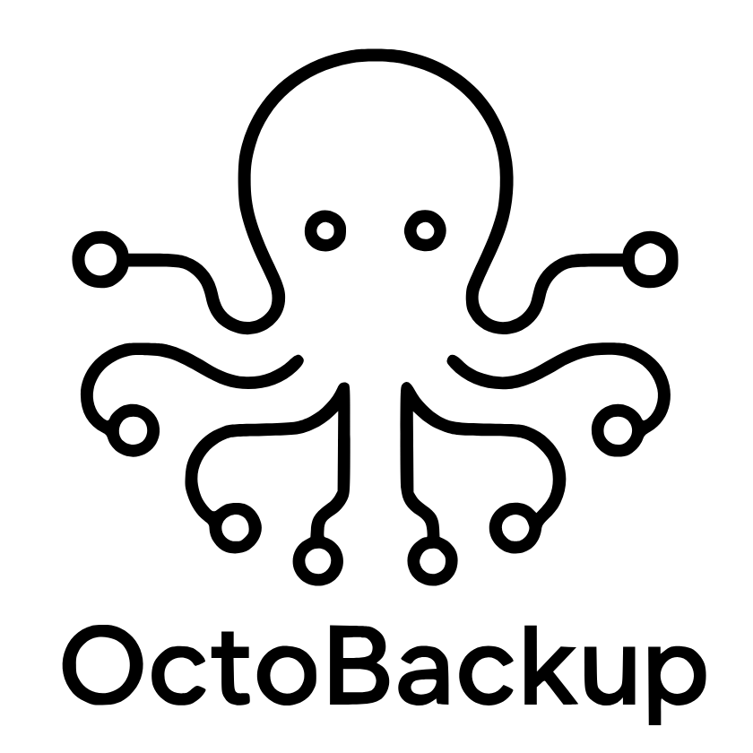
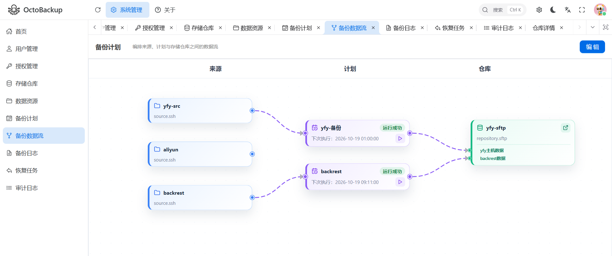
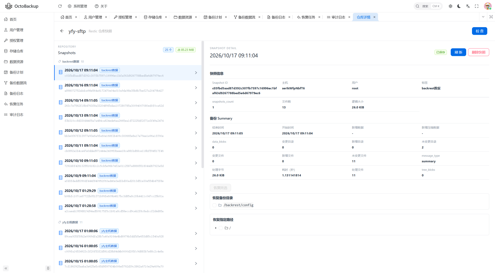

# OctoBack 章鱼备份

<center>

</center>


一个基于Restic的远程备份管理系统，像一只章鱼一样，从多个远程主机备份到多个远程存储仓库。

直观的可视化界面，避免错误命令误操作。




## 核心能力

 - web可视化操作
 - 存储仓库管理（SFTP、阿里云 OSS）
 - 主机管理
 - 备份任务管理
   - 备份任务执行流程 
     1. 从数据库中读取备份任务配置
     2. 根据任务配置生成 restic 配置文件
     3. 将resitc程序本体（根据主机平台类型选择）和restic配置文件 上传到目标主机
     4. 在目标主机上执行restic备份命令，从目标主机将备份到存储repo（实际上这个是restic自己本身的能力）
     6. 更新备份任务状态为已完成
 - 备份数据管理
     1. 可视化查看备份数据
     2. 从备份repo恢复数据到目标主机


备份快照详情




## API 文档

启动后端后可在 [Swagger UI](http://127.0.0.1:3000/swagger/) 查看和调试接口，OpenAPI JSON 位于 `/swagger/doc.json`。

后端接口发生变化时，在 `backend` 目录执行以下命令更新提交的文档：

```powershell
swag init --generalInfo app.go --output docs --parseInternal
```

## 终端管理

在 `backend` 目录运行 `go run . --admin` 可进入终端管理界面。选择“重置用户密码”后输入用户名和新密码，选择“退出”返回命令行；管理模式不会启动 Web 服务。

